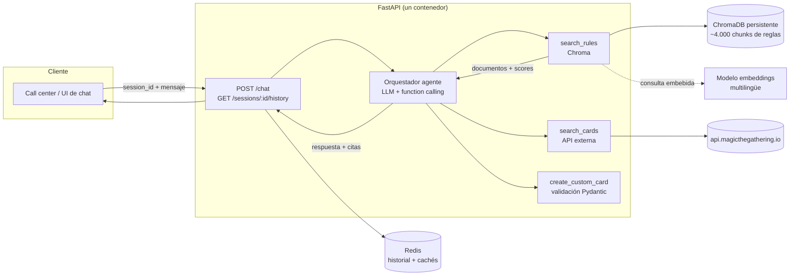
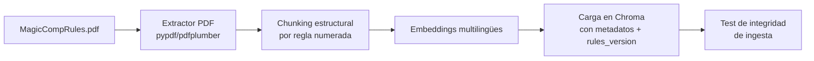

# Arquitectura — Chatbot de reglas de Magic: The Gathering

> **Entregable 1 del enunciado**: documento que describe la solución completa productiva (servicios, tipo de agentes, monitorización, etc.).
>
> El stack de la demo es deliberadamente simple y pragmático: **FastAPI + ChromaDB + Redis + LLM vía API**. Este documento explica esa arquitectura, por qué se eligió cada pieza, cómo se valida (especialmente la búsqueda semántica) y qué cambia al llevarla a producción.

---

## 1. Contexto y requisitos

Un call center que resuelve dudas de Magic: The Gathering quiere automatizar respuestas con un chatbot. Los insumos son:

- **Reglamento**: el *Comprehensive Rules* (PDF de ~260 páginas, altamente estructurado: reglas numeradas `100`–`9xx` con sub-reglas `NNN.x`, ejemplos marcados y un glosario al final).
- **API pública de cartas**: [magicthegathering.io](https://docs.magicthegathering.io/) (`GET /v1/cards` con filtros por color, coste, tipo, subtipo, texto, etc.).

| # | Capacidad pedida | Naturaleza técnica real | Componente responsable |
|---|---|---|---|
| R1 | Dudas de reglas básicas ("¿qué fases hay en un turno?") | **RAG** sobre el reglamento | Retrieval (Chroma) + LLM con citas |
| R2 | Interacciones entre cartas ("si cambio mi criatura tras el daño de dañar primero, ¿se aplica?") | **RAG multi-paso + razonamiento justificado** | Retrieval (Chroma) + LLM con citas |
| R3 | Búsqueda de cartas por descripción ("carta blanca de coste ≤2 que sea guerrero") | **Tool calling**: NL → filtros estructurados → API externa | LLM function-calling + cliente API cartas |
| R4 | (Bonus) Cartas custom ("carta de Han Solo blanca-roja con dañar primero") | **Generación estructurada validada** | LLM + schema Pydantic |

**Restricción clave del enunciado**: no se evalúa la veracidad de las respuestas, pero sí *que puedan justificarse*. Esto convierte la **trazabilidad (citar reglas concretas) en un requisito de primera clase**, y descarta de partida enfoques tipo "fine-tuning" o "el LLM se sabe las reglas": la arquitectura debe ser RAG con citas verificables.

---

## 2. Decisiones técnicas y justificación

### 2.1 Backend: FastAPI

| Aspecto | Decisión | Por qué |
|---|---|---|
| Framework | **FastAPI** | Async nativo (las llamadas al LLM y a la API de cartas son I/O-bound), validación de entrada/salida con Pydantic (crítico para R3 y R4), OpenAPI autogenerado para que el call center integre el chatbot fácilmente, y `TestClient` para tests de integración. |
| Contrato de respuesta | `answer` + `citations[]` + `cards[]` + `intent` | La justificación es un campo del contrato, no un adorno del prompt. Cada respuesta lleva las reglas (número + texto) y/o cartas que la sustentan. |
| Estilo | Capas delgadas: `api/` (rutas), `services/` (lógica), `agent/` (orquestación LLM+tools), `scripts/` (ingesta/eval) | Separar la ingesta del serving permite re-generar el índice sin tocar el servicio. |

### 2.2 Vector DB: ChromaDB (modo embebido, persistente)

| Aspecto | Decisión | Por qué |
|---|---|---|
| Motor | **Chroma con `PersistentClient`** | Para la demo, una vector DB embebida elimina un servicio más que desplegar. El índice es un directorio (`data/chroma/`) que se construye offline y se monta read-only en el contenedor. |
| Distancia | Espacio **coseno** | Estándar para embeddings de texto; hace comparables scores entre queries. |
| Metadatos por chunk | `{rule_id, rule_number, chapter, chapter_title, type: rule|glossary, rules_version}` | Permite filtrar (p. ej. solo glosario), citar ("regla 702.7 — Habilidades clave") y versionar el reglamento. |
| Alternativas descartadas | FAISS (sin metadatos ni persistencia cómoda), Qdrant/pgvector (correcto para producción, sobredimensionado para la demo) | Ver §9: en producción se sustituye Chroma por una vector DB gestionada sin cambiar el contrato del servicio de retrieval. |

### 2.3 Memoria: Redis

| Uso | Estructura | Detalle |
|---|---|---|
| Historial de conversación | `LIST chat:{session_id}` | `LPUSH` + `LTRIM 0 N-1` para conservar solo los últimos N turnos (p. ej. 20 mensajes) y `EXPIRE` 24 h. El historial se recupera en cada petición y se inyecta en el prompt. |
| Resumen de contexto largo (opcional) | `STRING summary:{session_id}` | Si la sesión supera N turnos, un resumen LLM sustituye a los turnos antiguos. "Cositas simples": en la demo basta el trim. |
| Caché de respuestas de la API de cartas | `STRING cards:{hash(params)}`, TTL 24 h | La API externa tiene rate limit; el 99% de las búsquedas de cartas se repiten. Reduce latencia y dependencia externa. |
| Caché semántica de respuestas (opcional) | `STRING anscache:{hash(pregunta normalizada)}` | Preguntas frecuentes del call center responden al instante. Riesgo: preguntas contextuales (pronombres) no cacheables → solo cachear si el clasificador marca la pregunta como autónoma. |

**Qué NO va en Redis**: embeddings, documentos, nada persistente de negocio. Redis aquí es memoria volátil de sesión + caché; si se pierde, se degrada la conversación pero no el conocimiento.

### 2.4 Modelos

| Pieza | Decisión | Nota |
|---|---|---|
| Embeddings | **Multilingüe** (p. ej. `intfloat/multilingual-e5-base` o `BAAI/bge-m3`) vía sentence-transformers, o API de embeddings | Decisión forzada por el problema cruzado de idioma: **las preguntas llegan en español y el reglamento está en inglés**. Un embedder monolingüe inglés hundiría el recall. Ver validación §7. |
| LLM | Cualquier LLM con function calling vía API | El chatbot necesita tool calling (R3) y salida citada (R1/R2). El LLM nunca "sabe" las reglas: las recibe en el contexto. |

---

## 3. Arquitectura de la demo



**Pipeline offline (ingesta), separado del serving:**



### Flujo de una petición `POST /chat`

1. **Validación de entrada** (Pydantic): `session_id`, `message`.
2. **Carga de memoria**: historial desde Redis (`LRANGE`), cacheado de contexto si aplica.
3. **Orquestación (agente)**: un único bucle de tool-calling con máximo de iteraciones (p. ej. 5):
   - El LLM decide qué herramientas invocar y con qué argumentos.
   - `search_rules(query)` → embeddea la pregunta → `collection.query` (top-k=6) → devuelve reglas con número y score.
   - `search_cards(filters)` → valida filtros con Pydantic → consulta la API externa (con caché Redis) → devuelve cartas (nombre, coste, tipos, texto, imagen).
   - `create_custom_card(spec)` → genera JSON de carta validado contra schema.
4. **Generación de respuesta**: prompt sistema con instrucciones de citar (usar SIEMPRE los números de regla recuperados; si no hay reglas suficientes, decirlo explícitamente), historial, herramientas y documentos recuperados.
5. **Post-procesado**: extracción estructurada de citas (se exige al LLM formato `{"answer": ..., "citations": [...]}` validado con Pydantic), persistencia del turno en Redis.
6. **Respuesta**: `{answer, citations: [{rule_number, title, text, score}], cards: [...], intent, latency_ms, trace_id}`.

### Por qué un solo agente (y no multi-agente) en la demo

Los cuatro requisitos se resuelven con **un agente con tres herramientas**. La "inteligencia" de enrutado (¿es pregunta de reglas, de búsqueda o de interacción?) la hace el propio LLM al elegir herramientas — no hace falta un clasificador de intents separado ni orquestadores tipo LangGraph. Esto es deliberado: menos componentes = menos puntos de fallo y una demo explicable en una entrevista. La evolución multi-agente llega en producción (§9.2), cuando los sub-problemas (re-ranking, descomposición de interacciones, evaluación continua) justifican la separación.

---

## 4. Pipeline de ingesta del reglamento

El Comp Rules es un corpus **jerárquico y numerado**. La estrategia de chunking es el mayor factor de calidad de todo el sistema:

1. **Extracción**: texto plano del PDF con `pypdf`/`pdfplumber`. El documento es digital (no escaneado), por lo que no hace falta OCR.
2. **Parseo estructural** con regex sobre los números de regla:
   - Cada chunk = **una sub-regla `NNN.x`** (o regla raíz `NNN` si no tiene sub-reglas), con el **título del capítulo** incluido en el texto del chunk para dar contexto al embedder y al LLM.
   - Los ejemplos (`Example:`) se mantienen junto a su regla.
   - El **glosario** se trocea por término, con `type: glossary` (término del glosario = puente natural entre el vocabulario del usuario —"dañar primero"— y la regla técnica —702.7—).
3. **Tamaño objetivo**: 100–600 tokens por chunk. Las reglas son atómicas: **no se usa solapamiento (overlap)**, porque cortar una regla por la mitad o duplicarla a medias degrada la cita.
4. **Metadatos**: `rule_number`, `chapter`, `chapter_title`, `type`, `rules_version` (fecha del PDF). El versionado permite re-ingestar un reglamento nuevo de forma atómica (colección nueva o filtrado por versión) sin dejar citas inconsistentes.
5. **Validación de integridad** (ver §7.1) antes de publicar el índice.

**Mejora conocida y diferible**: *small-to-big retrieval* (embedder sobre sub-reglas, pero pasar al LLM la regla padre completa con sus hermanas). En Chroma se puede emular con los metadatos; se deja como mejora porque el chunking por regla ya cumple el requisito de cita precisa.

---

## 5. Memoria conversacional (Redis) — detalle

```
chat:{session_id}      LIST   [turno_n, ..., turno_1]   TTL 24h, LTRIM a 20
summary:{session_id}   STRING resumen LLM (opcional)     TTL 24h
cards:{sha256(params)} STRING JSON de respuesta API      TTL 24h
anscache:{sha256(q)}   STRING respuesta autónoma (opc.)  TTL 1-7 días
```

Decisiones:

- **Memoria a corto plazo explícita**: cada petición reconstruye el contexto desde Redis → el servicio es **stateless** y escala horizontalmente sin sticky sessions.
- **Poda por turnos, no por tokens**: `LTRIM` fijo es determinista y barato; controlar tokens va en el ensamblado del prompt.
- **Preguntas dependientes del contexto** ("¿y esa carta vuela?"): se resuelven con el historial en el prompt, sin re-embeddear la pregunta (el retrieval de reglas rara vez depende del turno anterior; el de cartas se re-lanza como herramienta con el contexto ya en el LLM).
- **No cachear** respuestas de preguntas con anáforas o referencias a turnos previos: solo se cachean cuando la pregunta es autosuficiente.

---

## 6. Búsqueda de cartas (R3) y cartas custom (R4)

### R3 — De lenguaje natural a filtros validados

1. El LLM, vía function calling, produce argumentos estructurados contra un **schema Pydantic**:
   ```python
   class CardFilters(BaseModel):
       colors: list[Literal["W","U","B","R","G"]] | None
       cmc_max: int | None            # "coste inferior a dos" → 1
       subtypes: list[str] | None     # "guerrero" → ["Warrior"]
       types: list[str] | None
       text: str | None               # texto libre que debe aparecer
   ```
2. Validación Pydantic → **traducción de términos ES→EN la hace el LLM** ("blanco"→`W`, "guerrero"→`Warrior`, "dañar primero"→`First strike`), porque la API externa solo entiende inglés.
3. Cliente `httpx` con timeout, reintentos y **caché en Redis**; `User-Agent` identificable y respeto del rate limit de la API.
4. El LLM redacta la respuesta presentando las cartas (nombre, coste, imagen vía `imageUrl`) y explicando **qué filtros aplicó** — de nuevo, justificación.

**Error de diseño a evitar**: meter las cartas en Chroma y resolver R3 por similitud semántica. Las cartas ya tienen estructura perfecta (color, CMC, tipos) y una fuente autoritativa actualizada — el problema es de *query building* validado, no de similitud. La búsqueda semántica solo tendría sentido como fallback para descripciones vagas ("carta que roba cartas al entrar").

### R4 — Cartas custom (bonus)

- Tool `create_custom_card(spec)`: el LLM genera un JSON de carta contra schema (nombre, colores, coste, tipo, texto de reglas) validado con Pydantic.
- El texto de reglas generado se contrasta contra las reglas reales de las habilidades pedidas (p. ej. recuperar la definición de *dañar primero* de Chroma e incluirla en la respuesta): otra vez, **justificación con base documental**.
- La demo devuelve el JSON; la generación de imagen es opcional y no bloquea.

---

## 7. Validación de la búsqueda semántica

Esta es la parte del sistema con mayor riesgo técnico y la que se valida de forma más sistemática. Cuatro capas:

### 7.1 Integridad de la ingesta (tests unitarios, CI)

- Todos los números de regla esperados (100–907 + glosario) están presentes exactamente una vez.
- Ningún chunk supera el tamaño máximo de tokens; ninguno está vacío.
- Los metadatos obligatorios existen en el 100% de los chunks.
- Idempotencia: re-ejecutar la ingesta no duplica chunks.

### 7.2 Golden set de retrieval (evaluación offline)

- **~40–50 pares (pregunta en español → regla esperada)** cubriendo: turnos y fases, pila, mana, zonas, combate, habilidades clave (dañar primero, prisa, vigilancia...), glosario, e interacciones típicas.
- Ejemplos:

  | Pregunta (ES) | Regla esperada |
  |---|---|
  | ¿Qué fases hay en un turno? | 505.1 (Turn Structure) |
  | ¿Cómo funciona el daño de combate? | 510 (Combat Damage Step) |
  | ¿Qué significa dañar primero? | 702.7 + glosario |
  | ¿Cuándo puedo lanzar un instantáneo? | 307 + 117 (Timing) |
  | Si una criatura sale del combate, ¿se deshace el daño ya hecho? | 510 / 506.4 |

- **Métricas**: `Recall@5`, `MRR@10`, `hit@k` sobre el chunk recuperado. El script `scripts/eval_retrieval.py` imprime la tabla y se ejecuta en CI.
- **Umbral de gate en CI**: p. ej. Recall@5 ≥ 0.8 para pasar. Cualquier cambio de modelo de embeddings, tamaño de chunk o prompt de query re-ejecuta el eval → **anti-regresión del retrieval**.

### 7.3 Validación cruzada de idioma

- Caso explícito del golden set: pregunta en español ↔ regla en inglés. Es el test que detecta un embedder monolingüe mal elegido (fallaría estrepitosamente) y el que justifica el modelo multilingüe.
- Los términos del glosario actúan de puente bilingüe; se mide su contribución comparando recall con y sin chunks de glosario.

### 7.4 Umbral operativo y respuesta honesta

- Si el mejor documento recuperado supera una **distancia umbral** (calibrada sobre el golden set, p. ej. percentil 90 de los negativos), el sistema responde explícitamente que no ha encontrado base en el reglamento y ofrece escalar a un humano — **nunca improvisa una regla**.
- En producción (§9.4): muestreo nocturno de conversaciones reales con LLM-as-judge (¿la respuesta está sustentada por las citas?) + feedback 👍/👎 del usuario como métrica de calidad continua.

### 7.5 Evaluación end-to-end de respuestas (promptfoo)

Sobre el retrieval (7.2) se añade una capa que evalúa el **endpoint `/chat` completo por HTTP** (agente + herramientas + respuesta) con **promptfoo**:

- **Asserts deterministas del contrato de justificación** (sin coste de tokens, funcionan incluso en modo demo): la respuesta trae `citations[]`, los números de regla tienen formato válido, las citas de interacciones de combate apuntan a reglas 5xx/702.x, y para R3/R4 (con LLM real) los resultados cumplen los filtros pedidos (carta blanca, custom con los colores pedidos).
- **Asserts de calidad opcionales** con LLM real: `llm-rubric` / `factuality` con un juez (la respuesta lista las cinco fases, cita reglas...).
- **Doble juez (consenso inter-rater)**: cada test de calidad se evalúa con **dos modelos jueces distintos** usando la misma rúbrica (`eval/promptfoojudges.yaml`); `threshold` controla el criterio de consenso (por defecto: ambos deben aprobar). Mitiga el sesgo del evaluador único — un test aprobado por jueces de dos familias distintas es mucho más robusto, y la divergencia entre jueces señala tests a revisar manualmente. Los jueces son configurables (`JUDGE_1`/`JUDGE_2`) para cruzar proveedores (OpenAI + Anthropic/Groq...).
- Corre como servicio one-shot (`docker compose --profile tools run --rm promptfoo`) y en CI; los tests de R3/R4 se auto-saltan si `llm_provider=mock`.

**Alternativa considerada**: DeepEval (métricas pytest-native tipo faithfulness con LLM-judge, buena si queremos integrar el juez dentro de nuestra suite `pytest`). Elegimos promptfoo porque evalúa la API de verdad de forma declarativa (YAML reutilizando el golden set), porque el "cliente" del test es el mismo HTTP que usará el call center, y porque los asserts deterministas del requisito de justificación no consumen tokens. DeepEval queda como opción si en producción queremos faithfulness cuantitativo en CI.

---

## 8. Monitorización y observabilidad

### Demo

- **Logs estructurados JSON** con `trace_id`, `session_id`, `intent` inferido, herramientas invocadas, `rule_ids` recuperados con sus scores, tokens consumidos y latencias por fase (`retrieval_ms`, `llm_ms`, `total_ms`). Middleware de FastAPI.
- Endpoints `GET /health` (liveness: Chroma accesible, Redis accesible, API externa reachable) y `GET /metrics` (Prometheus: peticiones, latencia por fase, hit-rate de caché, ratio de "no encontrado").
- **Stack de visualización opcional** (`docker compose --profile observability up -d`):
  - **Prometheus + Grafana**: dashboard provisionado (requests/s por ruta, p95 de `/chat`, llamadas por tool, errores 5xx) leyendo `/metrics`.
  - **Dozzle**: logs de todos los contenedores en vivo desde el navegador.
  - **Langfuse self-hosted** (web + worker + Postgres + ClickHouse + MinIO + Redis): trazas de LLM — cada generación con prompt completo, tools invocadas, tokens y coste, agrupadas por `session_id`/`trace_id` (la app lo lleva integrado vía drop-in wrapper de OpenAI, activable con `LANGFUSE_ENABLED=true`; alternativa sin contenedores: Langfuse Cloud).

### Producción

- **Tracing distribuido** OpenTelemetry (HTTP + spans de LLM y retrieval).
- **Trazas de LLM** con Langfuse/LangSmith: prompt completo, documentos recuperados, coste por petición — imprescindible para depurar calidad de respuestas y coste.
- **Dashboards**: p95 de latencia, tasa de citas por respuesta (respuestas sin cita = alerta), drift del recall (golden set ejecutado contra índice nuevo antes de desplegar), hit-rate de caché, errores de la API externa.
- **Alertas**: subida del ratio de "no encontrado" (posible regresión de embeddings), degradación de la API de cartas, consumo de coste por sesión.

---

## 9. Evolución a producción

### 9.1 De la demo a producción — qué cambia por componente

| Componente | Demo | Producción |
|---|---|---|
| API | Un contenedor FastAPI + Uvicorn | Detrás de API gateway (auth, rate limiting, WAF); réplicas HPA |
| Vector DB | Chroma embebido persistente | Vector DB gestionada (Qdrant Cloud / pgvector en RDS) — el contrato del servicio de retrieval no cambia, solo su implementación |
| Memoria | Redis single | Redis gestionado con persistencia AOF |
| Ingesta | Script manual | Worker programado: re-ingesta al publicarse nuevo reglamento + sincronización de nuevas expansiones desde la API de cartas; índice azul/verde con `rules_version` |
| LLM | Una clave, un modelo | Router de modelos (barato para clasificación, potente para razonar), budgets por sesión, fallbacks |
| Observabilidad | Logs + /metrics | OTel + Langfuse + dashboards + alertas (§8) |
| Calidad | Golden set en CI | + evaluación continua nocturna + feedback de usuario |

### 9.2 Tipos de agentes (producción)

En producción, cuando el volumen y la complejidad lo justifiquen, el agente único se especializa:

1. **Agente router**: clasifica la petición (regla / interacción / búsqueda / custom) y enruta; permite prompts y modelos especializados por caso.
2. **Agente de reglas (RAG)**: retrieval + re-ranking + respuesta citada.
3. **Agente de interacciones (R2)**: descompone el problema — identifica las cartas mencionadas, extrae las habilidades implicadas (*dañar primero* → 702.7; *paso de daño de combate* → 510; *cambio de control* → 701.4 / 502.7), recupera todas las reglas relevantes y razona paso a paso con ellas.
4. **Agente de búsqueda de cartas (R3)**: builder de queries validado + presentación de resultados.
5. **Agente generador (R4)**: cartas custom con schema estricto y validación de coherencia con las reglas citadas.
6. **Agente evaluador (offline)**: batch nocturno con LLM-as-judge sobre muestras de tráfico real (faithfulness: ¿la respuesta se deriva de las citas?).

En la demo, 1–5 colapsan en el orquestador con herramientas de §3; el 6 se reduce al golden set de §7.

### 9.3 Despliegue

- **Demo**: `docker-compose` con `app` (FastAPI) + `redis`; el volumen de Chroma se construye en el build/ingesta y se monta read-only.
- **Producción**: Kubernetes, secrets gestionados, entornos dev/staging/prod, CI/CD con gates de calidad (tests + eval de retrieval), IaC (Terraform).

### 9.4 Seguridad y riesgos

| Riesgo | Mitigación |
|---|---|
| Prompt injection vía texto de cartas de la API externa | El contenido externo se marca y se incluye como *datos*, no como instrucciones; truncado de campos largos; el prompt sistema fija el rol |
| Alucinación de reglas | RAG-only + umbral de recuperación + formato de respuesta con citas validado; respuesta honesta si no hay base |
| Rate limit / caída de la API de cartas | Caché Redis, timeout + circuit breaker, degradación elegante ("la búsqueda de cartas no está disponible") |
| Coste LLM | Caché semántica, router de modelos, presupuesto por sesión |
| Datos de usuarios del call center | Retención mínima (TTL Redis), sin PII en logs, cumplimiento GDPR |

---

## 10. Estructura del repositorio de la demo

```
.
├── ARQUITECTURA.md            # este documento
├── MagicCompRules.pdf         # reglamento fuente
├── docker-compose.yml         # app + redis
├── Dockerfile
├── requirements.txt / pyproject.toml
├── app/
│   ├── main.py                # FastAPI app + middleware (logs, trace_id)
│   ├── core/config.py         # settings (pydantic-settings)
│   ├── api/routes.py          # POST /chat, GET /health, GET /sessions/{id}/history
│   ├── agent/
│   │   ├── orchestrator.py    # bucle tool-calling (máx. iteraciones)
│   │   └── tools.py           # search_rules, search_cards, create_custom_card
│   ├── services/
│   │   ├── retrieval.py       # cliente Chroma (embed + query + umbral)
│   │   ├── cards_api.py       # cliente magicthegathering.io (caché, timeouts)
│   │   ├── memory.py          # historial Redis (LTRIM, TTL)
│   │   └── llm.py             # cliente LLM
│   └── models/schemas.py      # Pydantic: ChatRequest/Response, CardFilters, Citation
├── scripts/
│   ├── ingest_rules.py        # PDF → chunks → embeddings → Chroma
│   └── eval_retrieval.py      # golden set → Recall@k / MRR
├── eval/golden_set.jsonl      # pares pregunta→regla (ES→EN)
└── tests/                     # integridad de ingesta + API (TestClient)
```

## 11. Orden de implementación (roadmap de la demo)

1. **Ingesta + integridad**: extractor, chunking estructural, carga en Chroma, tests 7.1.
2. **Retrieval + golden set**: eval con Recall@5/MRR, elección del embedder multilingüe, calibrado del umbral (7.2–7.4).
3. **Chat básico (R1)**: `/chat` + agente con `search_rules` + memoria Redis + respuestas citadas.
4. **R2 interacciones**: mismo pipeline, con prompt de descomposición (cartas → habilidades → reglas); el requisito de justificación ya está cubierto por las citas.
5. **R3 búsqueda de cartas**: tool `search_cards` con schema validado + caché.
6. **R4 bonus**: `create_custom_card`.
7. **Empaquetado**: docker-compose, README de ejecución, smoke test end-to-end.
